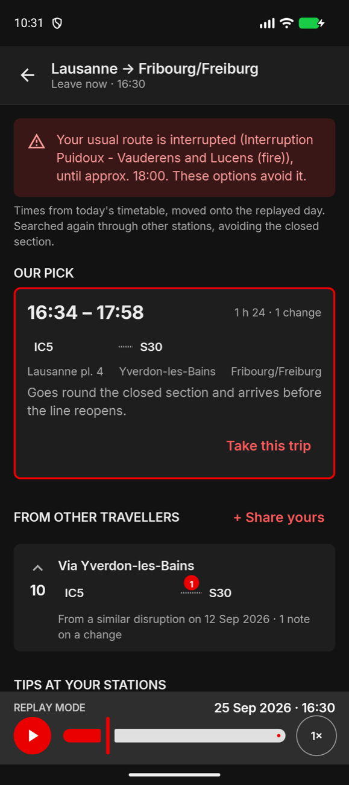
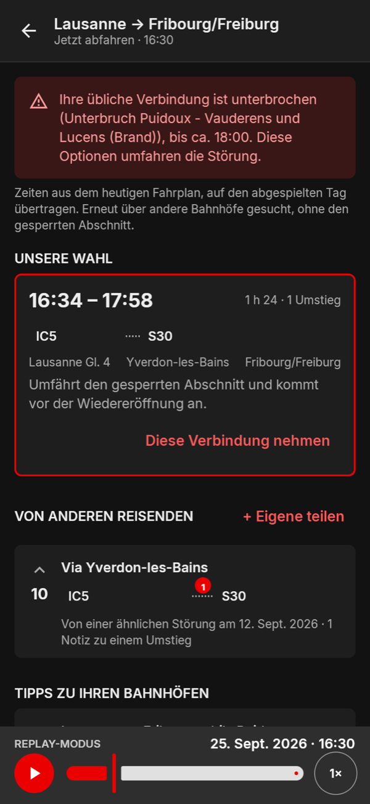
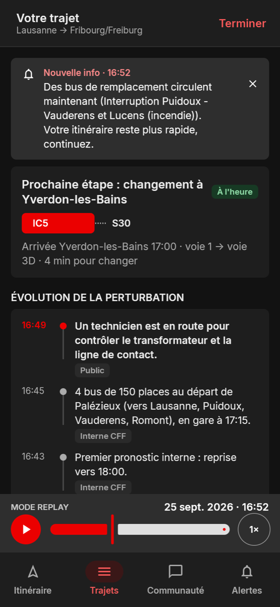
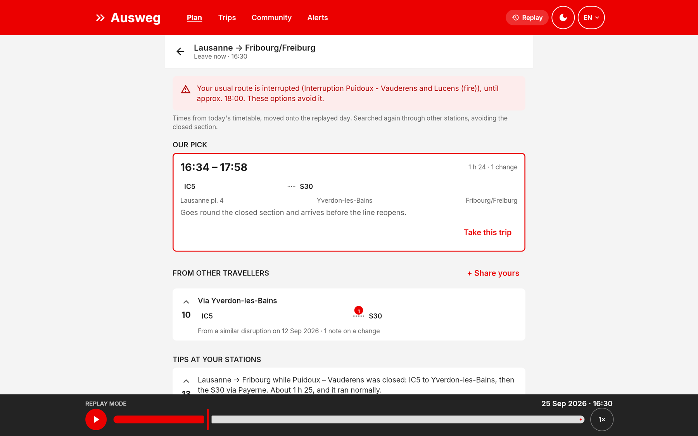
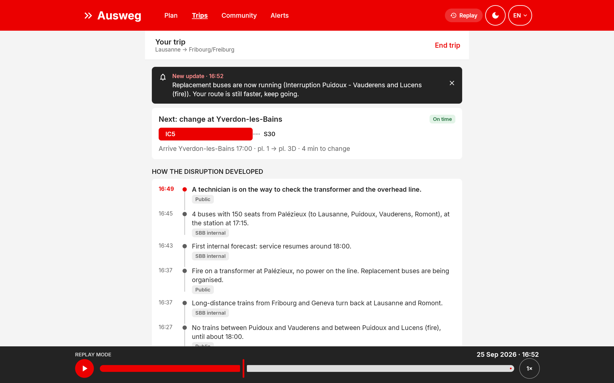
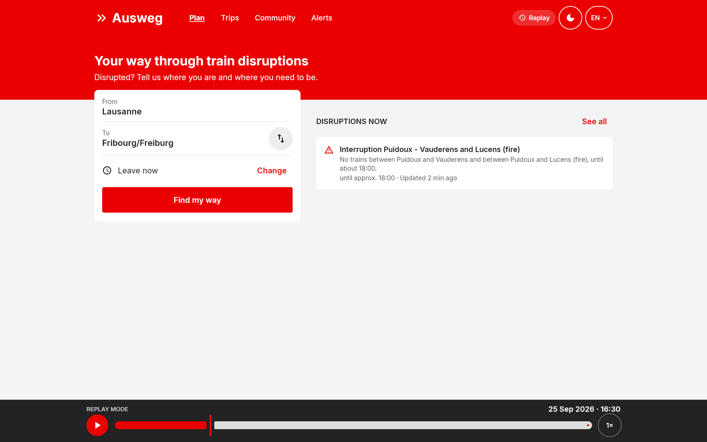
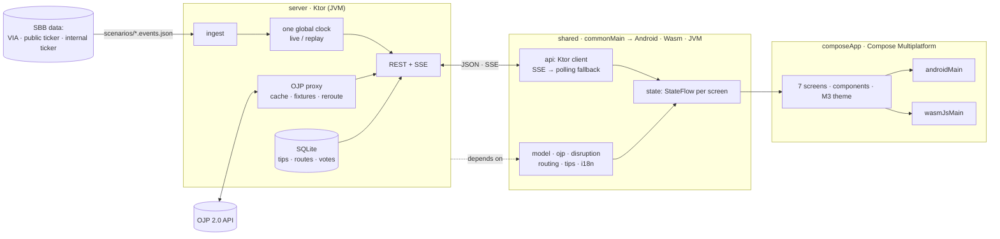
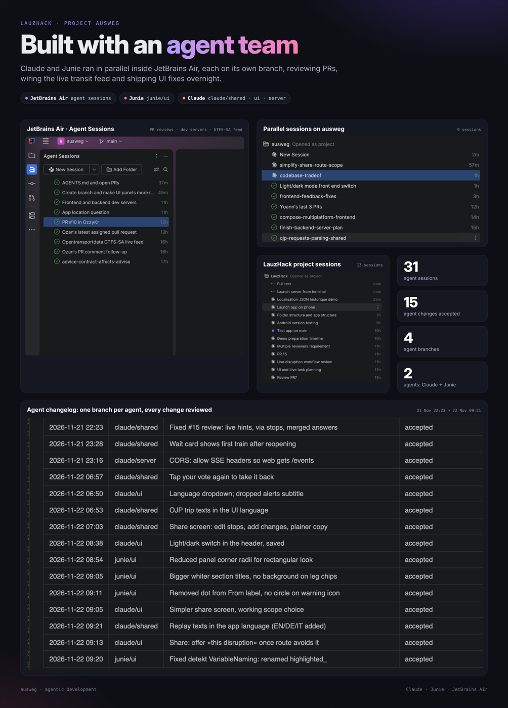

# Ausweg

**A journey planner for train disruptions.** When the line is cut, Ausweg answers the one question travellers have:
*«what should I do now?»* For your trip, not for the network in general.

**Android + Web (Wasm) from one Kotlin Multiplatform codebase, with a Kotlin/Ktor backend that runs the same shared
logic.** 98.8 % of the client code is `commonMain`. The platform layer is 93 lines.

<p>
  
  
  
</p>

<sub>Left: Android emulator. Middle and right: the same Compose code in a mobile browser (Wasm), in German and French.
All three: the replayed Puidoux–Vauderens fire of 25 Sep 2026, 16:30.</sub>



---

## Contents

1. [The problem](#the-problem)
2. [What it does](#what-it-does)
3. [Architecture](#architecture)
4. [What is shared, what is platform-specific](#what-is-shared-what-is-platform-specific)
5. [Technical highlights](#technical-highlights)
6. [Architecture decisions and trade-offs](#architecture-decisions-and-trade-offs)
7. [Quality gates](#quality-gates)
8. [Built with an agent team in JetBrains Air](#built-with-an-agent-team-in-jetbrains-air)
9. [Run it](#run-it)
10. [Repository map](#repository-map)

---

## The problem

We joined three real SBB datasets for September 2026 (the VIA disruption system, the public live ticker and the
internal control-centre ticker) and measured what travellers actually got
(`python data/scripts/pitch_stats.py`, details in [`data/README.md`](data/README.md)):

- **15 min** median between an incident being created and its first publication.
- Only **21 %** of 168 incidents ever got a travel recommendation, and only **18 %** got replacement-bus info.
- Renens–Morges, 17 Sep: replacement buses were known internally at 19:08 and published at 20:02, **54 min** later.

Travellers on the platform don't need a network map. They need a decision.

## What it does

| Step | What the user sees | What runs |
|---|---|---|
| **Plan** | From / to, "Find my way", the disruptions happening now | Debounced stop search (`PlanState`), `/state` over SSE |
| **Options** | A red banner if the usual trip is blocked; **«Our pick»**: *go*, *wait until it reopens*, *take the replacement bus* or *detour*, with the reason | Server: OJP search, hub reroute, `rankTrips()`. App: `planOptions()` + `advise()` |
| **Community** | Routes and transfer tips from other travellers, ranked, with «still valid?» votes | `rankTips()` / `rankRoutes()`, SQLite, SSE `community` event |
| **Live trip** | Next change and platform, **an update banner only when your advice or ETA changes**, and how the disruption developed (public and SBB internal) | `progress()`, `routeUpdate()`, timeline |
| **Share** | Edit the route you actually took, add a tip at a change, show it «during this disruption» or «always» | `ShareState`, `RouteEdits.kt`, `stopsTrain()` safety check |

Two modes, one pipeline: **historical replay** (a real disruption, minute by minute, with a server-side simulated
clock you can play, pause, seek and speed up) and **live** (today's OJP data and today's real disruptions).

<p>
  
  
</p>

## Architecture



- **`shared`** compiles to **three** targets. The JVM target exists so the **server reuses the shared logic**: the
  backend decides to reroute with the same `affects()` the app uses to tell you your trip is blocked. The server and
  the clients run the same `affects()`, `advise()`, `rankTrips()`, `rankTips()`, `disruptionsFrom()` and OJP parser.
- **`composeApp`** is pure rendering: composables collect shared `StateFlow`s and call methods.
- **`server`** owns the clock, the OJP key, the SBB data and the community database.

Every decision behind this structure is written down in **[`docs/architecture.md`](docs/architecture.md)** (13
records: decision, why, cost). The API is in [`docs/api.md`](docs/api.md).

## What is shared, what is platform-specific

| Source set | Kotlin lines | What's in it |
|---|---:|---|
| `shared/src/commonMain` | **4,677** | Models, OJP 2.0, disruption engine, routing, ranking, i18n, Swiss time, API client, all screen state |
| `composeApp/src/commonMain` | **3,213** | All 7 screens, components, Material 3 light/dark theme |
| `composeApp/src/androidMain` | 42 | `MainActivity`, `SharedPreferences` settings, `BackHandler` |
| `composeApp/src/wasmJsMain` | 51 | `ComposeViewport`, `localStorage` settings, `?api=` URL, `BackHandler` |
| `shared/src/{android,jvm,wasmJs}Main` | **0** | Nothing. Only the Ktor engine differs, chosen in Gradle (OkHttp / CIO / JS) |
| `server/src/main` | 2,044 | Ktor routes, ingest, replay clock, OJP proxy, SQLite store |
| Tests (`shared` + `server`) | 5,726 | 276 tests |

**Client code in `commonMain`: 7,890 of 7,983 lines = 98.8 %.** The platform seams and why each one exists:

| Seam | Android | Web (Wasm) | Mechanism |
|---|---|---|---|
| Key-value storage (voter id, language, theme, my votes) | `SharedPreferences` | `localStorage`, in-memory if blocked (private mode) | `Settings` interface in shared, injected |
| Backend URL | `BuildConfig.API_URL` (`-Pausweg.apiUrl=`) | `?api=`, or the page's host on port 8080 | Entry-point argument |
| System languages | `LocaleList` | `navigator.languages` | Entry-point argument |
| Back navigation | System back button | App back arrows | `expect`/`actual` `BackHandler` (the only one) |
| HTTP engine | OkHttp | Fetch (JS) | Gradle dependency per target |

The app object lives outside the Android activity (`AppHolder`), so rotation, dark-mode or language changes keep the
plan, the options and the taken trip.

## Technical highlights

### A disruption engine you can reason about
- **`affects(trip, disruptions)`** matches each leg against closed sections in either direction by **DIDOK station
  number**. The number comes from OJP SLOIDs (`ch:1:sloid:7000:4:7` → `8507000`, border stations included), so
  "Fribourg/Freiburg" vs "Fribourg" can never cause a mismatch. `LINE_CLOSED` blocks every non-walk leg,
  `REPLACEMENT_BUS` blocks rail only, cancelled legs and skipped stops count, and legs leaving after `expectedEnd`
  are open again.
- **`advise(trip, disruptions, now, alternatives)`** returns a sealed `Advice` (`Ok` / `Wait` / `Detour` /
  `TakeBus`) plus an `AdviceReason`. It waits if waiting arrives within 5 min of the best detour (less hassle),
  detours if the end is unknown, offers the bus if nothing else gets through, and never suggests a detour that has
  already left. «Wait» shows the **first train after the reopening**, not the blocked one (PR #17).
- **Update banners** (`routeUpdate()`) fire only when *your* advice or ETA changes: blocked, resolved, buses
  running, end moved. A new text with the same consequence stays silent.

### OJP 2.0, fully in `commonMain`
- Request builders (trip, location, stop event; all input XML-escaped) and a namespace-agnostic parser on
  `xmlutil`, running unchanged on Android, Wasm and the JVM server.
- **Live situations become disruptions** (`disruptionsFrom()`): the section comes from the text («zwischen X und Y»,
  «entre X et Y», «tra X e Y»), keyword rules in 4 languages set `LINE_CLOSED` / `REPLACEMENT_BUS`, and validity
  windows decide ACTIVE / ENDED (night works don't block your afternoon). We checked this on 20 real situations: the
  12 active ones with a section phrase got the right section. An IC listed under a closure *elsewhere on its route*
  only warns, so you aren't sent on a false detour (PR #14).
- Texts are parsed in German (keywords and station names are reliable there), then fetched once more in the UI
  language for display (PR #18).

### One clock, two modes, zero divergence
- The server keeps one global clock (LIVE or HISTORICAL, up to 3600× speed). A disruption version is visible only
  when `publishedAt ≤ clock.now`, in both modes. Internal-ticker events count too, so the app reacts **when SBB
  knew**, not when it published.
- In replay, OJP (which only knows today's timetable) is queried on the same weekday and time this week, and the
  trips are moved back onto the replayed day (`source: SHIFTED`). With no key or no network, recorded answers are
  used (`source: FIXTURE`), **so the stage demo runs offline**.
- When every direct trip is blocked, the server searches again through up to 3 hubs that avoid the closed section
  (`rerouted: true`). Checked with a real OJP key: Lausanne → Fribourg at 16:30 during the fire goes via
  Yverdon–Payerne, and the direct IC1 / IR15 / S40 are marked blocked.

### Real-time that survives conference Wi-Fi
SSE `clock` / `state` / `community` events; the shared `liveEvents()` drops to polling `/state` every 3 s if SSE
breaks, then tries SSE again. Between heartbeats, the app advances the replay clock smoothly on its own.

### Community knowledge, ranked
Score = up − down + ½ (still valid − outdated) + 5 if staff-endorsed, halved every 30 days for disruption content.
Order: same disruption → **similar disruption** (shares a station and cause: «from a similar disruption on 12 Sep»)
→ permanent tips. Anonymous by design: a random voter id per device, one vote per target, tap again to take it back.
A shared route that still goes through the closed stretch can't be tagged «this disruption».

### Data pipeline with privacy by construction
Python scripts join the three SBB sources by time and place into scenario files, and `validate.py` checks them
(sorted, time zones, official names, DIDOK numbers). Internal texts are paraphrased. The server **never deserializes**
the `raw` field, and `PrivacyTest` proves no raw text reaches the API. Raw data is gitignored.

### i18n and theming
- **EN / FR / DE / IT, 195 keys each**, as JSON in `composeResources`, loaded by shared `Strings` with English as
  fallback, and switchable at runtime from the header. Replay texts are translated; live SBB texts are shown as
  published.
- A JVM test fails CI if any language misses a key or a `{placeholder}`, or if any `t("…")` call uses an unknown key.
- `SwissTime` shows Swiss local time everywhere, whatever the device zone. On Wasm this is done without a tz database.
- **Material 3 light and dark**, a header toggle (follows the device until you tap it, then remembers your choice), the Inter font, ~20 vector icons
  (no icon dependency), and a **wide web layout** at ≥ 900 dp (top bar with tab links, two-column plan page)
  from the same composables.

## Architecture decisions and trade-offs

Every technology has limits. These were deliberate choices for a 36-hour build with a live stage demo. Full records
are in [`docs/architecture.md`](docs/architecture.md).

| Decision | Why it was the right call for us | What we consciously left out |
|---|---|---|
| **Shared module also powers the server** | The backend and the app cannot disagree about whether a trip is blocked: there is one `affects()`. | `shared/model` is an API for three consumers, so fields are additive only (enforced by `ContractsTest`). |
| **Keyword rules, not an LLM** | Travel advice must be reproducible: the same message always gives the same advice. Explainable, unit-tested in 4 languages, offline, free per request. | A closure phrased without «zwischen X und Y» shows as a warning, not a block: we'd rather under-block than send people on false detours. |
| **OJP behind our server** | The API key never ships in an APK or JS bundle. Caching (60 s) and throttling (250 ms) happen in one place. Recorded fixtures make the demo network-proof. | The app needs our backend; there is no direct OJP mode. |
| **Replay on today's timetable** | Lets us replay any real disruption with real OJP routing, not a mock. | Replayed trips are moved from this week's timetable, so they have no realtime data or cancellations from that day. |
| **Curated reroute hubs** | 11 checked hubs, at most 3 extra searches: predictable latency and OJP cost, and the right answers for western Switzerland. | Not a general graph search. Adding a region means adding hubs to `data/routing/hubs.json`. |
| **One global server clock** | Phone and laptop show the same replayed minute on stage, and replay and live share one code path. | One replay at a time for all clients: a demo server, not multi-tenant. |
| **Live disruptions come with `/plan`** | They are computed for the trips you actually asked about, at your departure time. | In live mode `/state` and SSE carry no disruptions yet; the trip screen re-plans instead. |
| **Station numbers over names** | DIDOK numbers are the one identifier the SBB data, OJP and the scenarios share. | Live OJP texts name stations in prose, so section detection there still matches names (carefully: shorter names never match inside longer ones). |
| **Wasm for the web** | Compose's fastest web target and where Compose for Web is heading; same UI code as Android. | Needs a WasmGC browser. Without a tz database we compute Swiss time with the EU DST rule (Swiss-only by design). |
| **Own `Settings` + `Navigator`** | No dependencies, fully unit-tested in `commonMain`, 93 lines of platform code in total. | No deep links, and the browser's back button isn't wired (the app's back arrows are). |
| **Android + Web, no iOS** | We had two platforms to polish, not three to half-finish. `shared` has no platform code, so iOS is a new entry point, not a port. | iOS isn't built or tested. |
| **Anonymous community** | No accounts, no personal data, nothing to leak. | A voter id can be reset; staff endorsement uses a demo token. |
| **Logic tests, no UI tests** | 276 tests where the behaviour is: parsers, matchers, rankers, state holders. The UI only renders. | Screens were verified by hand (headless Chrome + emulator). CI runs shared tests on the JVM and compiles Android and Wasm. |
| **Pinned toolchain** | Kotlin 2.2.21 · Compose MP 1.9.3 · AGP 8.12.3 · Ktor 3.3.3: a stable set; `xmlutil` 0.91.3 is the last release built with Kotlin 2.2. | The upgrade to Kotlin 2.4 / AGP 9 is planned as its own PR. |

## Quality gates

- **276 tests**: 197 in `shared/commonTest` (24 test classes, fixtures from recorded OJP situations and the real Puidoux
  scenario), 3 i18n file checks in `shared/jvmTest`, 76 in `server` (routes with Ktor `testApplication`, SSE,
  folding of the real scenarios, privacy, OJP service, SQLite store).
- **ktlint + detekt fail CI.** Findings are fixed, not suppressed; the few `@Suppress` carry a one-line reason.
- **CI** ([`.github/workflows/ci.yml`](.github/workflows/ci.yml)): lint + tests, Android APK, Wasm bundle, server
  distribution, on every PR. **CD** ([`cd.yml`](.github/workflows/cd.yml)): APK, web bundle and server zip as
  artifacts, optional GitHub Pages deploy, GitHub Release on `v*` tags.
- **One rule held from the first PR to the last:** `main` always builds, and the historical demo always runs.

## Built with an agent team in JetBrains Air

Claude and Junie worked in parallel inside JetBrains Air, each on its own branch and area, while we reviewed and
steered. The repo is set up so that any agent can join cold:

- **[`AGENTS.md`](AGENTS.md)** (Junie reads it through the `.junie/guidelines.md` symlink): areas
  (`shared` / `ui` / `server` / `infra`), branch names `<agent>/<area>/<task>`, tagged commits, lint and test gates,
  and the rule that only a human merges. It includes an architecture summary.
- **The [`shared-first-feature`](.claude/skills/shared-first-feature/SKILL.md) skill**: contract → pure logic → state
  holder → tests → UI → strings in 4 languages → gate → log → PR.
- **[`AGENT_LOG.md`](AGENT_LOG.md)**: one row per agent task (49 so far: 45 Claude across shared, server, ui and
  infra; 4 Junie on ui), each with the human reviewer's verdict.

**We steered rather than rubber-stamped.** A few examples from the 23 merged PRs:

| PR | What the human review caught | What changed |
|---|---|---|
| #4 Scenario data | One `section` per event can't describe Puidoux–Vauderens *and* Puidoux–Lucens; the agent had set reviewer-only `accepted` cells in the log | `section` → `sections` in both scenarios and `validate.py`; log cells reverted to `pending` |
| #7 Server demo path | A bug visible in the historical demo: any event naming a section closed the line | Only closing kinds close; `rerouted` only when the reroute found new trips (`920d9dc`) |
| #10 / #13 / #14 Shared logic | Trips that had already left came back as picks; «Bern» matched inside «Bern Wankdorf»; an express through a closure vanished | Fixed with tests (`e545d03`, `846611f`, `e47059a`); the express now shows with a warning |
| #15 Live disruptions | 4 findings: a whole-line stop list blocked unrelated trips, reroutes lost hubs, duplicate versions, missing situations | All 4 fixed with regression tests (`b8d5be6`) |
| #22 UI polish (Junie) | "Please fix linting" | Junie fixed detekt `VariableNaming` in a follow-up commit (`b201220`) |

<details>
<summary>Agent sessions overview (poster)</summary>


</details>

## Run it

Needs **JDK 21**, and the Android SDK for the app. An OJP token is **optional**: without one, the server answers
from recorded fixtures.

```bash
./gradlew :server:run                               # backend on :8080 (PORT to change)
./gradlew :composeApp:wasmJsBrowserDevelopmentRun   # web app; it talks to <host>:8080, or ?api=http://host:port
./gradlew :composeApp:assembleDebug                 # Android APK; the emulator reaches the host at 10.0.2.2:8080
./gradlew :composeApp:assembleDebug -Pausweg.apiUrl=http://192.168.1.20:8080   # a phone on the same Wi-Fi
```

| Variable | What |
|---|---|
| `OJP_API_TOKEN` | OJP 2.0 token from opentransportdata.swiss (env, `.env` or `local.properties`); never committed |
| `OJP_RECORD=1` | Record every OJP answer into `data/fixtures/ojp/` |
| `STAFF_TOKEN` | Enables staff endorsement (`X-Staff-Token`) |
| `AUSWEG_DB`, `AUSWEG_DATA_DIR`, `AUSWEG_SCENARIOS` | Move the database and the data folders |

**60-second demo:** open the web app → **Replay** → *Puidoux–Vauderens (fire)*. Lausanne → Fribourg is filled in.
Seek to **16:30** → *Find my way*: the direct IC1 is blocked, and «Our pick» goes via Yverdon–Payerne, with a
community route from a similar disruption on 12 Sep. *Take this trip* → seek to **16:52** → the banner says
replacement buses are running and your route is still faster. Switch the language or theme in the header at any
point; open the same URL on a phone to see the shared clock.

Lint and tests: `./gradlew ktlintCheck detekt :shared:jvmTest :server:test`.

## Repository map

```
shared/        KMP logic for Android · Wasm · JVM: model · ojp · api · disruption · routing · tips · i18n · state
composeApp/    Compose Multiplatform UI: screens · components · theme · i18n JSON; tiny androidMain / wasmJsMain
server/        Ktor: ingest · replay · ojp · tips (SQLite) · events (SSE) · api
data/          scenarios/ (2 real disruptions) · fixtures/ojp/ · routing/hubs.json · seed/ · scripts/ (Python)
docs/          architecture.md (decision records) · api.md (REST + SSE contract) · screenshots/
AGENTS.md      Rules and architecture summary for every agent and human · AGENT_LOG.md: every agent task, reviewed
.claude/skills/shared-first-feature/   How to add a feature, step by step
```
