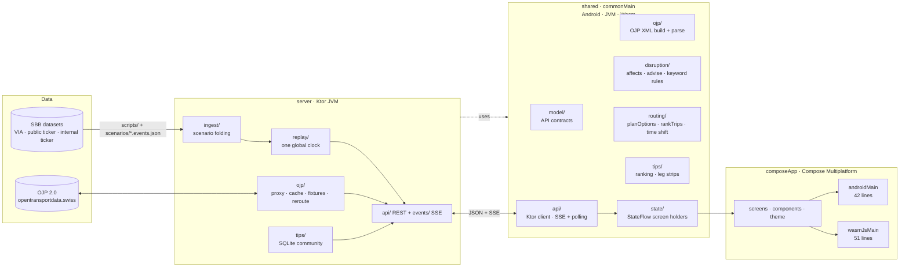

# Architecture decisions

The decisions that shape Ausweg, why we took them, and what they cost. Each one is short on purpose. Read this
before you change how modules talk to each other. Agents should also read [`AGENTS.md`](../AGENTS.md) and the
[`shared-first-feature`](../.claude/skills/shared-first-feature/SKILL.md) skill.

## System at a glance

`shared` is compiled for **three** targets: Android and Wasm for the app, and JVM for the server. The server and the
clients run the same `affects()`, `advise()`, `rankTrips()`, `rankTips()`, `disruptionsFrom()` and the same OJP parser.

---

## ADR-1 · One `shared` module, used by the clients *and* the server

- **Decision.** `shared/src/commonMain` holds the models, OJP parsing, disruption matching, advice, ranking,
  i18n, time formatting and every screen's state. It targets `androidTarget()`, `wasmJs()` and `jvm()`. The JVM
  target exists so that `server/` can depend on it (`implementation(projects.shared)`).
- **Why.** The server decides whether to reroute with the same `affects()` that the app uses to say "your trip is
  blocked". If the two copies ever disagreed, the app would contradict the server. With one copy they can't.
- **Cost.** A change in `shared/model` is an API change for three consumers. We keep new fields additive with
  defaults, and `ContractsTest` checks that old JSON still decodes.

## ADR-2 · Screen state lives in shared code; composables only render

- **Decision.** One state holder per screen in `shared/state/` (`PlanState`, `OptionsState`, `TripState`,
  `ShareState`, `CommunityState`, …) exposes a `StateFlow<…Ui>`. `AuswegApp` is the facade that wires them, and
  `Navigator` holds the tabs and back stack. Composables read `collectAsState()` and call methods. Nothing else.
- **Why.** All behaviour (debounced stop search, re-running advice on every server event, update banners, voting,
  route editing) runs in plain coroutines and is unit-tested in `commonTest` against a `FakeApi`, with no UI test
  framework. Android and Web cannot drift apart, because there is nothing platform-specific to drift.
- **Cost.** We wrote our own small `Navigator` instead of a navigation library: no deep links or browser-history
  integration. We kept it because it is 100 % testable and has no dependency.

## ADR-3 · Compose Multiplatform for every screen; Android + Web (Wasm)

- **Decision.** All 7 screens and every component are in `composeApp/src/commonMain`. The platform source sets hold
  only the entry points: `MainActivity` and `main()` with `ComposeViewport`.
- **Why.** One UI codebase gives a pixel-identical product on phone and browser. A width breakpoint (≥ 900 dp)
  gives the web a desktop layout (top bar, two columns) without a second UI.
- **Cost.** Wasm needs a modern browser (WasmGC). We chose Wasm over Kotlin/JS for its performance and because it
  is where Compose for Web is heading.

## ADR-4 · Platform seams are tiny interfaces, injected at the entry point

- **Decision.** The platform provides only what it must: storage (`Settings` interface: `SharedPreferences` on
  Android, `localStorage` with an in-memory fallback on the web), the backend URL (`BuildConfig.API_URL` or
  `?api=`), the system languages, and `BackHandler` (the only `expect`/`actual`). The Ktor engine is chosen per
  target in Gradle (OkHttp, CIO, JS), not in code.
- **Why.** An interface in shared code with a `MemorySettings` test double beats `expect`/`actual` for anything
  tests need to fake. The whole platform layer is 93 lines.
- **Cost.** No settings library: we only store a few strings (voter id, language, theme, my votes), so a library
  wasn't worth the dependency.

## ADR-5 · The backend owns one clock; replay and live share one pipeline

- **Decision.** `server/replay/` holds one global clock: LIVE (wall time) or HISTORICAL (a replayed day, playable,
  seekable, up to 3600× speed). A disruption version becomes visible only when `publishedAt ≤ clock.now`, in both
  modes. The app never uses the device clock for decisions: `advise()` receives `now` from the server.
- **Why.** The stage demo replays a real disruption of 25 Sep 2026 minute by minute, and the code path is the one
  that runs live. Every connected device (phone and laptop) shows the same moment.
- **Cost.** One clock means one shared replay for all clients: ideal for a demo, not multi-tenant.

## ADR-6 · OJP 2.0 lives behind our server, with three sources of truth

- **Decision.** The app never calls OJP. `POST /plan` asks OJP (key on the server, 60 s cache, 250 ms minimum gap
  between calls). In replay mode it searches the same weekday and local time this week and moves the trips back
  onto the replayed date (`source: SHIFTED`). If OJP fails or there is no key, it uses recorded answers from
  `data/fixtures/ojp/` (`source: FIXTURE`). If every trip is blocked, it searches again through up to 3 hubs from
  `data/routing/hubs.json` (`rerouted: true`).
- **Why.** The API key never ships in an APK or JS bundle. Rate limits are enforced in one place. The stage demo
  runs without network access.
- **Cost.** OJP only knows the current timetable, so replayed trips use today's timetable and have no realtime
  data. Rerouting tries a curated hub list, not a graph search: 11 hubs cover western Switzerland, our demo area.

## ADR-7 · Stations are matched by number, never by name

- **Decision.** Every stop carries its DIDOK number. `didokOf()` derives it from OJP SLOIDs
  (`ch:1:sloid:7000:4:7` → `8507000`, and border stations 80/81/83/87). Scenario files map names to numbers with
  `stationIds`, and `validate.py` checks them.
- **Why.** "Fribourg", "Fribourg/Freiburg" and "Freiburg" are one station. Names in the SBB data, OJP and user
  input disagree; numbers don't.
- **Cost.** Live OJP situations name their sections in free text, so there we must match names against the
  situation's stops (shorter names never match inside longer ones: PR #13).

## ADR-8 · Deterministic keyword rules, no AI model at runtime

- **Decision.** `disruption/SituationKeywords.kt` reads DE/FR/IT/EN texts: «unterbrochen / interrompu / interrotto»
  → `LINE_CLOSED`, «Ersatzbus / bus de remplacement» → `REPLACEMENT_BUS`, «zwischen X und Y / entre X et Y / tra X e
  Y» → the closed section. Everything else is a warning.
- **Why.** Travel advice must be reproducible, explainable and testable: the same message always gives the same
  advice, offline and with no cost per request. An LLM would have been a forced fit (we decided against Koog here).
- **Cost.** A closure written without a «zwischen» phrase only warns instead of blocking. We prefer to under-block
  than to send people on a false detour (PR #15).

## ADR-9 · Decisions are pure functions of (trip, disruptions, now)

- **Decision.** `affects()`, `advise()`, `planOptions()`, `rankTips()`, `routeUpdate()` and `progress()` take
  everything as arguments and do no I/O.
- **Why.** The app re-runs them on every SSE `state` event and on every clock tick. A banner appears only when the
  *advice or ETA* changes, not when a text changes (`RouteUpdates.kt`), because the user should be told at the
  right moment. Pure functions make that cheap and easy to test (`AdvisorTest` + `MatchingTest` +
  `RouteUpdatesTest`: 39 tests on fixtures from the real Puidoux scenario).

## ADR-10 · Push first, poll as fallback

- **Decision.** `GET /events` (SSE) sends `clock`, `state` and `community` events. The shared `liveEvents()` falls
  back to polling `/state` every 3 s when SSE breaks (proxy, browser), then tries SSE again. `LinkStatus` tells the
  UI which mode it is in.
- **Why.** On stage, Wi-Fi and proxies are unreliable. The demo must keep moving.

## ADR-11 · i18n as JSON resources, loaded by shared code, checked by a test

- **Decision.** `composeResources/files/i18n/{en,fr,de,it}.json` (195 keys each, `{placeholder}`s), loaded into the
  shared `Strings` with English as fallback. Shared code builds keys (`I18nKeys`) for advice reasons, banners,
  durations and dates. `shared/src/jvmTest/.../I18nFilesTest.kt` fails CI if any language misses a key or a
  placeholder, or if any `t("…")` call in `composeApp` uses a key that doesn't exist.
- **Why.** Shared logic formats user-facing text («until approx. 18:00», «11 min ago»), so strings must be reachable
  from `commonMain`, testable on the JVM, and switchable at runtime from the header.
- **Cost.** Swiss time is computed by hand (`SwissTime`, EU DST rule), because `TimeZone.of("Europe/Zurich")` needs
  the `@js-joda/timezone` npm package on Wasm. Swiss-only, by design.

## ADR-12 · Privacy by construction

- **Decision.** Raw SBB datasets are gitignored. Internal-ticker texts are paraphrased into `summary` fields. The
  `raw` field is never even deserialized by the server, and `PrivacyTest` proves that no raw text reaches `/state`.
  Community content is anonymous: a random voter id generated on the device, no accounts.

## ADR-13 · The repository is built to be worked on by agents

- **Decision.** [`AGENTS.md`](../AGENTS.md) (`.junie/guidelines.md` is a symlink to it, so Junie reads the same rules) defines areas, branch names
  (`<agent>/<area>/<task>`), tagged commits, lint and test gates, and the rule that a human merges.
  [`AGENT_LOG.md`](../AGENT_LOG.md) records every agent task with the reviewer's verdict. The
  [`shared-first-feature`](../.claude/skills/shared-first-feature/SKILL.md) skill describes how to add a feature
  across `shared` → `composeApp` → i18n → tests.
- **Why.** Claude and Junie worked in parallel in JetBrains Air. The rules made their PRs small, reviewable and
  mergeable without conflicts (`AGENT_LOG.md` uses `merge=union`).
